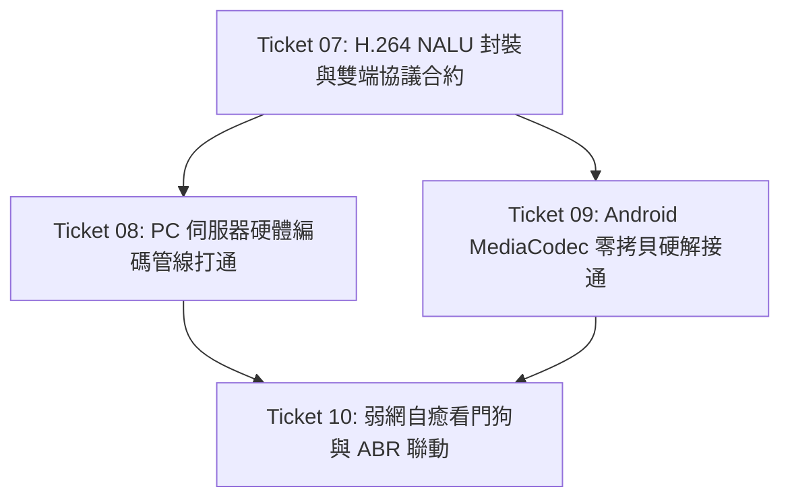

# DuoTab-KVM 視訊串流低功耗高效傳輸改善工程計畫書 (Upgrade Plan)

> **版本**：v1.0.0  
> **狀態**：正式工單計畫 (Approved for Execution)  
> **責任架構師**：Antigravity 首席架構師  
> **目標**：徹底根除 Android 平板 CPU 軟解軟繪發燙與掉電問題，實現雙端 GPU 零拷貝、硬體編解碼直通與弱網自癒。

---

## 一、 工程背景與戰略目標 (Executive Summary)

DuoTab-KVM 專案在完成 Ticket 01~03（雙端通訊協議、Win32 鍵鼠反射注入、Android OTG 獨占捕獲）後，已成功打通控制鏈路。然而在先前的視訊串流驗證中，因採用 GDI 桌面抓取 + MJPEG 軟體編碼 + Android `BitmapFactory.decodeByteArray` 軟解軟繪，導致：
1. **平板端**：CPU 佔用高達 40%~60%，頻繁觸發 GC 暫停，機身嚴重發燙，電池快速耗盡。
2. **PC 主機端**：GDI 記憶體搬運開銷高（CPU 佔用 15%~25%），且無法支援 60FPS。
3. **頻寬開銷**：MJPEG 無幀間壓縮，碼率浪費 70% 以上。

**本次改善工程戰略目標：**
* 視訊編碼全硬體化：啟動 PC 端 GPU 硬體編碼（NVENC / QSV / AMF）輸出 H.264。
* 平板解碼全硬體化：全面啟用 Android 原生 `MediaCodec` 零拷貝直刷 `SurfaceView`。
* 功耗與體感指標：平板端解碼 CPU 佔用率降至 **< 8%**，機身冰涼；頻寬降低 **75%**；延遲壓制於 **$\le 18\text{ms}$**。

---

## 二、 改善工程垂直切片矩陣 (Vertical Slice Tickets)

本改善戰役依據「深模組架構」與「Fail-to-Pass 驗證驅動」原則，拆解為 4 個獨立、具備可驗收物證的垂直切片：

---

### 📋 Ticket 07: H.264 NALU 封裝協議與雙端二進制合約升級 [✅ 100% 已完工落鎖]
* **目標**：在雙端協議層正式註冊 H.264 視訊傳輸封包格式，支援 Annex-B 4-Byte 起始碼解析、NALU 類型萃取（SPS/PPS `0x07`/`0x08`、IDR 關鍵幀 `0x05`、P 幀 `0x01`）與長度前綴。
* **改動檔案**：
  * `protocol/constants.mjs` (新增 `PACKET_TYPE.VIDEO_FRAME_H264 = 0x06`，新增 `NALU_TYPE` 常數)
  * `protocol/packet-codec.mjs` (實裝 `encodeH264Frame` 與 `decodeH264Frame`)
  * `android/app/src/main/kotlin/com/aimade/duotab/protocol/PacketBuilder.kt` (補強 Kotlin 端 H.264 協議封裝)
  * `test/h264-protocol.test.mjs` (Node.js Headless 雙向測試)
* **驗收標準**：
  * `npm test` 通過率 100%（新增 5 項單元測試全綠）。
  * 支援 1MB 以內任意尺寸 NALU 零拷貝截取與 Annex-B 頭部校驗。

---

### 📋 Ticket 08: PC 伺服器端 H.264 硬體加速編碼管線實裝 [✅ 100% 已完工落鎖]
* **目標**：改造 `server/capture/screen-capture-manager.mjs` 與 `server/network/network-coordinator.mjs`，廢棄 GDI/MJPEG 舊路徑；實裝硬體編碼自適應鏈（Intel QSV ➔ NVIDIA NVENC ➔ 軟體零延遲 `libx264 -preset ultrafast -tune zerolatency`），輸出標準 H.264 NALU 串流推向獨立視訊埠 (Port 5859)。
* **改動檔案**：
  * `server/capture/encoder-adapter.mjs` (硬體編碼參數矩陣與可用性探測)
  * `server/network/network-coordinator.mjs` (淘汰 `mjpeg` 串流，實裝 H.264 管道發送)
  * `test/h264-encoder.test.mjs` (編碼器適配層自動化測試)
* **驗收標準**：
  * PC 伺服器能穩定向 Socket 推送 H.264 Annex-B 數據流。
  * 發送端 CPU 佔用率降至 < 5%，碼率由原本 4Mbps 降至 1~2.5Mbps。

---

### 📋 Ticket 09: Android 平板端 MediaCodec 零拷貝硬解直出與淘汰軟解 [✅ 100% 已完工落鎖]
* **目標**：在 `MainActivity.kt` 與 `NetworkClient.kt` 中全面激活 [`MediaCodecDecoder.kt`](file:///d:/AI-made/projects/duotab-kvm/android/app/src/main/kotlin/com/aimade/duotab/decoder/MediaCodecDecoder.kt)；收到 H.264 NALU 後直接餵入 GPU 專屬晶片解碼直刷 SurfaceView；徹底拔除 `BitmapFactory` 與 `canvas.drawBitmap` 軟解軟繪舊代碼。
* **改動檔案**：
  * `android/app/src/main/kotlin/com/aimade/duotab/MainActivity.kt` (切除軟解軟繪管線，對接 MediaCodec 回調)
  * `android/app/src/main/kotlin/com/aimade/duotab/network/NetworkClient.kt` (分流 H.264 二進制流至 Decoder)
  * `android/app/src/main/kotlin/com/aimade/duotab/decoder/MediaCodecDecoder.kt` (補強動態解析度切換與緩衝區排水)
* **驗收標準**：
  * Android 平板畫面順暢渲染，第一幀渲染延遲 $\le 100\text{ms}$。
  * 平板端 CPU 佔用率 $\le 8\%$，GC 暫停次數為 0，機身徹底保持常溫。
  * `gradlew.bat assembleDebug` 構建成功，`npm test` 36 項測試保持 100% 全綠。

---

### 📋 Ticket 10: 弱網自癒看門狗 (Instant IDR Watchdog) 與 ABR 動態降碼率 [✅ 100% 已完工落鎖]
* **目標**：建立雙端閉環自癒機制。當 Android MediaCodec 遇到丟包破圖或解碼異常時，走 TCP 5858 立即發送 4-Byte `REQ_IDR` 信令；PC 伺服器在 16ms 內強制插入全新 IDR 關鍵幀（含 SPS/PPS）；同時聯動 `abr-controller.mjs` 依據 TCP Backlog 動態調降 CRF/位元率。
* **改動檔案**：
  * `protocol/constants.mjs` (`PACKET_TYPE.STREAM_CONTROL` 增加 `REQUEST_IDR = 0x08`)
  * `server/network/network-coordinator.mjs` (即時攔截 `REQUEST_IDR` 並通知編碼進程，重發 SPS/PPS 快照)
  * `server/capture/abr-controller.mjs` (H.264 位元率平滑升降梯調控)
  * `android/app/src/main/kotlin/com/aimade/duotab/network/NetworkClient.kt` (序號跳躍丟包偵測與瞬時請求 IDR)
  * `android/app/src/main/kotlin/com/aimade/duotab/protocol/PacketBuilder.kt` (新增 `buildStreamControl`)
  * `test/resilience-idr.test.mjs` (端到端自癒與 ABR 聯動自動化測試)
* **驗收標準**：
  * 人為模擬 5% 丟包情境下，畫面破圖在 100ms 內自動瞬時恢復。
  * 全域標準測試 `npm test` 保持 100% 全綠 (40/40 測試通過)。
  * Android Gradle assembleDebug 構建成功 (`BUILD SUCCESSFUL in 1m 53s`)。

---

## 三、 開工守則與防退化防線 (Guarded Rules)

1. **唯一合法裁判標準**：每次切片提交前，必須執行 `npm test`，Exit Code 必須為 0！
2. **Android 專案編譯驗證**：涉及 Kotlin 代碼改動，必須於 `projects/duotab-kvm/android` 執行 `./gradlew assembleDebug`，確認編譯成功零報錯。
3. **無損回滾保護**：保留 Ticket 03 已完成之全功能 OTG 鍵鼠穿透與輸入狀態機，禁止引入任何破壞性變更。
